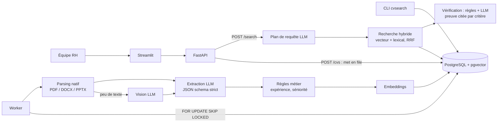

# CV Search

Mini-système de gestion et de recherche de CV pour une équipe RH : import de CV hétérogènes (PDF, DOCX, PPTX), extraction d'un profil structuré, stockage, puis recherche en langage naturel avec explication des résultats.

> Code, commentaires et docstrings en anglais ; documentation en français. Vocabulaire du domaine : [GLOSSARY.md](GLOSSARY.md). Décisions d'architecture : [docs/adr](docs/adr).

## Sommaire

1. [Architecture](#architecture)
2. [Choix techniques et métiers](#choix-techniques-et-métiers)
3. [Lancer le projet](#lancer-le-projet)
4. [API](#api)
5. [Évaluation de la pertinence](#évaluation-de-la-pertinence)
6. [Déploiement Azure](#déploiement-azure)
7. [Hypothèses, limites, pistes](#hypothèses-limites-pistes)

## Architecture



Trois processus qui partagent une même image : **api**, **worker** (ingestion asynchrone), **ui**. La file d'ingestion est une table PostgreSQL (pas de broker supplémentaire).

Organisation du code (`src/cvsearch`) :

| Module | Rôle |
|---|---|
| `parsing/` | Extraction native par format, repli vision pour les documents-images |
| `ingestion/` | Extraction LLM, pipeline, worker |
| `domain/` | Modèles et règles d'expérience (pur Python, testé unitairement) |
| `store/` | Schéma, file, profils, récupération hybride (tout le SQL) |
| `search/` | Compréhension de la requête, vérification des critères, classement |
| `embeddings/`, `llm/` | Adaptateurs interchangeables |
| `api/`, `ui/`, `cli.py` | Points d'entrée |
| `evaluation/` | Mesure de pertinence rejouable |

## Choix techniques et métiers

**Parsing.** Extraction native d'abord (peu coûteuse, déterministe), LLM ensuite pour structurer.
- PDF : détection de colonnes (gouttière verticale) puis lecture colonne par colonne. Sans cela, les CV à deux colonnes sont mélangés ligne à ligne.
- DOCX : parcours du XML pour lire paragraphes, tableaux **et zones de texte** (le CV `McTurland` n'a aucun paragraphe, tout est en zone de texte ; Word stocke chaque zone en double, la copie `Fallback` est ignorée).
- PPTX : ordre de lecture reconstruit depuis la géométrie des formes. Les **notes du présentateur sont ignorées** : dans le lot fourni, elles contiennent une légende de modèle (liste de fonctions et de compétences), pas des données du candidat, et fausseraient la recherche.
- Repli **vision** (gpt-5) si le texte natif est trop court : uniquement pour les documents-images (le DOCX `McTurland` embarque son contenu en images).

**Extraction.** gpt-5 en *structured output* strict (schéma Pydantic) : aucune sortie JSON à réparer. Secteur dans un vocabulaire fermé pour que les filtres soient fiables. Le prompt interdit d'inventer et normalise les dates françaises.

**Règles métier** ([ADR 0003](docs/adr/0003-experience-rules.md)) : les années d'expérience sont **calculées par le code**, pas par le LLM.
- Stages exclus, périodes qui se chevauchent comptées une fois, poste en cours arrêté à la date d'ingestion.
- Sans dates exploitables : durée affichée par le CV (« 3 years of experience »), sinon séniorité lue dans le titre (« Junior… ») et années laissées à 0 plutôt qu'inventées. La source du chiffre est toujours exposée (`experience_basis`).
- Années **par secteur** (« 10 ans dans le conseil »). Séniorité : junior < 2 ans, confirmé 2-5, senior ≥ 5.

**Recherche** ([ADR 0002](docs/adr/0002-verify-numeric-criteria-outside-the-llm.md)). La similarité vectorielle répond à « de quoi parle ce CV », pas à « qui a 10 ans de conseil ». Le pipeline :
1. le LLM transforme la requête en 2 à 5 **critères** (obligatoire / souhaité) et une description sémantique enrichie de synonymes ;
2. récupération **hybride** : meilleur passage par CV (pgvector, cosinus) + plein texte, fusionnés par RRF ;
3. critères chiffrés (années, secteur, séniorité) **vérifiés par le code** ; critères thématiques notés par le LLM avec **une preuve citée** du CV ;
4. classement : critères obligatoires satisfaits d'abord, puis score pondéré, puis rang de récupération.

Chaque résultat indique, critère par critère, le verdict, la preuve et son origine (`rules` ou `llm`). Quand personne ne remplit les critères obligatoires, la réponse l'indique (`no_full_match`) au lieu de présenter un faux palmarès. Pour la requête « Directeur Marketing, 10 ans de conseil », aucun profil du lot ne correspond, et c'est ce que le système répond.

**Stockage** ([ADR 0001](docs/adr/0001-postgres-pgvector-single-store.md)) : PostgreSQL + pgvector, un seul système pour profils (JSONB + colonnes filtrables), vecteurs (HNSW), plein texte et file. Un chunk « résumé » et un chunk par poste par profil, pour que la requête retrouve une expérience précise.

**Embeddings** ([ADR 0004](docs/adr/0004-local-embeddings-by-default-azure-in-cloud.md)) : la passerelle fournie n'expose aucun modèle d'embedding. Local et tests : `multilingual-e5-large` (FR/EN, 1024 dim, ONNX). Cloud : Azure OpenAI `text-embedding-3-small` déployé par Terraform, ramené à 1024 dimensions pour garder le même schéma. Changer de fournisseur impose de ré-ingérer (les fichiers sont conservés en base).

**Contraintes du LLM** ([ADR 0005](docs/adr/0005-reasoning-budget-and-output-cap.md)) : sorties limitées à 4000 jetons par la passerelle ; raisonnement `minimal`/`low` pour ne pas épuiser ce budget ; lots de 4 profils pour la notation ; reprises avec backoff sur 429/5xx.

**Robustesse.** Ingestion idempotente (hash SHA-256 du contenu) ; reprise automatique (3 tentatives) puis statut `failed` avec la cause, ré-essayable ; un worker planté est récupéré après 10 minutes ; plusieurs workers sans conflit ; suppression d'un CV = suppression de toutes ses données (RGPD).

**Sécurité.** Clé d'API (`X-API-Key`), mot de passe sur l'interface, base non exposée, secrets dans Key Vault, identité managée, aucun secret dans le dépôt.

## Lancer le projet

Prérequis : Docker (avec Compose), ou bien Python ≥ 3.11 et [uv](https://docs.astral.sh/uv/).

Il faut la clé de la passerelle LLM (variables `APIM_BASE_URL`, `APIM_SUBSCRIPTION_KEY`).

### Avec Docker (recommandé)

```bash
cp .env.example .env     # puis renseigner APIM_BASE_URL et APIM_SUBSCRIPTION_KEY
docker compose up --build -d      # premier build : ~10 min (le modèle d'embedding de 2 Go est inclus)
docker compose run --rm api cvsearch ingest data/cvs    # importe les 10 CV d'exemple
```

- Interface : <http://localhost:8501> (mot de passe : `CVSEARCH_UI_PASSWORD`)
- API et documentation interactive : <http://localhost:8000/docs> (en-tête `X-API-Key`)
- Recherche en ligne de commande : `docker compose run --rm api cvsearch search "Profil ayant développé des chatbots"`

### Sans Docker

```bash
uv sync --extra ui --extra local-embeddings
cp .env.example .env     # renseigner la passerelle ; DATABASE_URL doit pointer vers un PostgreSQL avec pgvector
uv run cvsearch ingest data/cvs
uv run cvsearch search "Data Ingénieur qui conçoit des data platforms sur AWS ou Azure"
uv run cvsearch api &  uv run cvsearch worker &  uv run streamlit run src/cvsearch/ui/streamlit_app.py
```

Versions : Python 3.12, dépendances figées dans `uv.lock` (`uv sync --frozen`). Le premier appel télécharge le modèle d'embedding (~2 Go).

### Qualité

```bash
make check      # ruff + mypy + pytest (31 tests, PostgreSQL embarqué, aucun appel réseau)
```

Les tests d'intégration utilisent un vrai PostgreSQL/pgvector embarqué (`pgserver`) et un faux LLM : ils vérifient le comportement par l'API (authentification, doublons, file, échecs, calcul d'expérience, classement, absence de correspondance).

## API

| Méthode | Route | Rôle |
|---|---|---|
| POST | `/cvs` | Met un ou plusieurs CV en file (202) ; doublon = sans effet |
| GET | `/cvs`, `/cvs/{id}` | Liste, statut (`queued`, `processing`, `done`, `failed`) |
| GET | `/cvs/{id}/profile` | Profil structuré |
| POST | `/cvs/{id}/retry` | Relance un CV en échec |
| DELETE | `/cvs/{id}` | Supprime le CV et ses données dérivées |
| POST | `/search` | `{"query": "...", "top_k": 5}` → profils classés avec explications |
| GET | `/health` | Sonde de vie |

## Évaluation de la pertinence

```bash
uv run cvsearch evaluate       # rejoue data/eval_cases.json (appelle le LLM)
```

Cinq requêtes de l'énoncé, avec les profils attendus (`expected`), interdits comme correspondance complète (`forbidden`), et le cas « aucune correspondance » attendu pour la requête Directeur Marketing. Résultat sur le lot fourni : **5/5 cas, rappel moyen 1,00**.

**Réserve honnête** : les profils attendus ont été établis par moi à la lecture des CV, avec seulement 10 CV et 5 requêtes ; c'est un garde-fou de non-régression, pas une mesure statistique. À faire relire par un recruteur.

## Déploiement Azure

Infrastructure Terraform ([infra/terraform](infra/terraform)) : Container Apps (api, worker, ui) dans un VNet, PostgreSQL Flexible Server privé avec pgvector, Azure OpenAI (embeddings), Key Vault (accès par identité managée), ACR, Log Analytics. Région `francecentral`, plus petits niveaux (estimation à confirmer dans le calculateur Azure : quelques dizaines d'euros par mois).

```bash
az login
infra/scripts/bootstrap.sh                                  # une fois : stockage de l'état Terraform
cp infra/terraform/terraform.tfvars.example infra/terraform/terraform.tfvars   # renseigner la passerelle
infra/scripts/deploy.sh                                     # infra + build ACR + déploiement
```

Le script affiche les URL et les commandes pour lire la clé d'API et le mot de passe générés. Suppression complète : `terraform -chdir=infra/terraform destroy`.

CI/CD (GitHub Actions) : `ci.yml` (ruff, mypy, tests, `terraform validate`, build de l'image) sur chaque PR ; `deploy.yml` sur `main` (authentification OIDC, aucun secret Azure stocké).

> **État de la livraison :** l'infrastructure est validée (`terraform validate`) mais **n'a pas été appliquée** depuis mon poste : `az` n'y est pas installé et il n'y a pas de session Azure. Le plan Terraform, la disponibilité du modèle d'embedding dans la région et les workflows GitHub n'ont donc pas été exécutés de bout en bout. L'image Docker n'a pas non plus été construite ici (accès au démon Docker refusé) ; le code, lui, a été exécuté en direct contre la passerelle réelle et un PostgreSQL/pgvector embarqué.

## Hypothèses, limites, pistes

- Un CV = un profil. Pas de fusion automatique si la même personne dépose deux CV différents (une mauvaise fusion détruit silencieusement des données).
- Les 10 CV d'exemple sont versionnés (`data/cvs`) pour la reproductibilité ; en production, les CV seraient stockés dans un Blob Storage chiffré avec une durée de conservation.
- L'ancienneté des postes sans date de début n'est pas estimée.
- Les secteurs sont déterminés par le LLM d'après l'employeur ; un cabinet de conseil/ESN est classé `consulting`.
- Latence : une recherche prend 10 à 60 s (appel de planification + notation de ~15 profils). Pistes : réduire le pool de candidats, mettre en cache les plans de requête, notation en flux.
- À l'échelle : le goulot est le LLM (quota et débit de la passerelle), pas la base. Pistes : files dédiées, `pgbouncer`, partitionnement, index plein texte avec dictionnaire français, reranker.
- Pas de mesure de qualité d'extraction par rapport à une vérité terrain annotée ; à construire avec les RH.
- L'authentification par clé partagée convient à une démonstration ; pour un usage réel, Entra ID (SSO) et une traçabilité des consultations.
